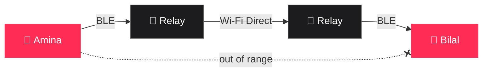

<div align="center">


# Droplet

**Messaging that keeps working when the network doesn't.**

End-to-end encrypted messages, calls and files that hop from phone to phone over Bluetooth and Wi-Fi.<br>
No internet. No carrier. No server in the middle.

[](https://github.com/rito27959-arch/droplet/actions/workflows/tests.yml)


[](LICENSE)

[**Website**](https://dropletmesh.app) &nbsp;·&nbsp; [**Download**](../../releases/latest) &nbsp;·&nbsp; [**Security**](https://dropletmesh.app/security/) &nbsp;·&nbsp; [**Support**](https://dropletmesh.app/support/)

<br>


</div>

<br>

## Why Droplet

Every messenger assumes the network is there. When coverage drops — an outage, a dead zone, no credit left — they all stop at once, exactly when you most need to reach someone.

Droplet starts from the opposite assumption: **there is no network.** Your phone already carries two radios that can reach another phone directly. Droplet uses them.

| Transport | Range | Used for |
|:--|:--|:--|
| Bluetooth LE | ~10–100 m | discovery, messages |
| Local Wi-Fi | high throughput | files, calls |
| Wi-Fi Direct | ~50–200 m | links without any infrastructure |

Out of direct range, a message travels through the devices in between — **up to five hops**. If nobody is around, it waits on the phone and leaves as soon as a device comes within reach (store-and-forward).



<sub>Relays carry bytes they cannot read. Only Amina and Bilal hold the keys.</sub>

## Features

<table>
<tr>
<td width="50%" valign="top">

**Conversations**
Chats and groups, quoted replies, reactions, read receipts, search.

**Calls**
Audio and video over a Wi-Fi link — Bluetooth, at nineteen bytes per write, cannot carry a voice.

**Media**
Photos, videos, files and voice notes.

</td>
<td width="50%" valign="top">

**Statuses**
Erased automatically after twenty-four hours.

**Offline map**
Works without a connection; positions are shared over the mesh.

**Safety**
An “I'm OK” signal and an emergency mode.

</td>
</tr>
</table>

## Security

| Layer | Design |
|:--|:--|
| **Identity** | An X25519 key pair generated on the device. The private key lives in the system keystore, never in the database. |
| **Direct messages** | ECDH → HKDF → AES-256-GCM, with a fresh random nonce for every message. |
| **Groups** | Sender-key ratchet with per-message HMAC derivation. |
| **Relays** | A phone that forwards a message carries ciphertext it cannot read. |

The full model is described at [dropletmesh.app/security](https://dropletmesh.app/security/).

## What Droplet does *not* do

An app that only lists its strengths asks to be taken at its word. So here are the limits, stated plainly.

- **It does not replace the internet.** It reaches your neighbourhood, extended by relays — not the other side of the country.
- **It does not hide your presence.** Devices announce themselves to find each other. The content is unreadable; the presence is not.
- **It is slower than a network.** A relayed message can wait hours for a path to open.
- **It cannot give your identity back.** No server means no account recovery: without an exported backup, a lost phone takes everything with it.
- **On its own, it does nothing.** A mesh is built by many.

## Install

Android 7.0 or later. Each release ships one APK per architecture:

| File | For |
|:--|:--|
| `app-arm64-v8a-release.apk` | most recent phones |
| `app-armeabi-v7a-release.apk` | older phones |
| `app-x86_64-release.apk` | emulators, some tablets |

Droplet can also **share itself** over Bluetooth or Wi-Fi Direct — neither sender nor recipient needs a connection. It is the only distribution channel consistent with what the app claims to be.

## Build from source

```bash
flutter pub get
flutter test
flutter build apk --release --split-per-abi
```

Release signing reads `android/key.properties`, which is intentionally **not** in this repository — see `android/app/build.gradle.kts`.

<details>
<summary><strong>Repository layout</strong></summary>

<br>

| Path | Contents |
|:--|:--|
| `lib/` | The Flutter app: mesh transports, crypto, chats, calls, design system |
| `droplet_server/`, `serveur/` | Small companion services (call signalling, push wake-ups) |
| `droplet_directory/`, `droplet_mailbox/` | Directory and mailbox services used when a connection exists |
| `android/`, `ios/` | Platform projects |
| `site/` | Legacy static site (`python3 site/construire.py` builds `site/public/`) |
| `test/` | Unit and widget tests |

</details>

## Status

**Public testing.** The app works; it is not finished. If you try it: *Settings → Error log → **Send***. Droplet has no server collecting crash reports, so a bug you don't send does not exist for anyone.

## License

[MIT](LICENSE)

<br>

<div align="center">
<sub>
<a href="https://dropletmesh.app">Droplet</a> &nbsp;·&nbsp;
<a href="https://dropletid.dropletmesh.app">Droplet ID</a> &nbsp;·&nbsp;
<a href="https://drop.dropletmesh.app">Droplet Drop</a> &nbsp;·&nbsp;
<a href="https://web.dropletmesh.app">Droplet Web</a>
<br><br>
Designed and built in Yaoundé, Cameroon.
</sub>
</div>
